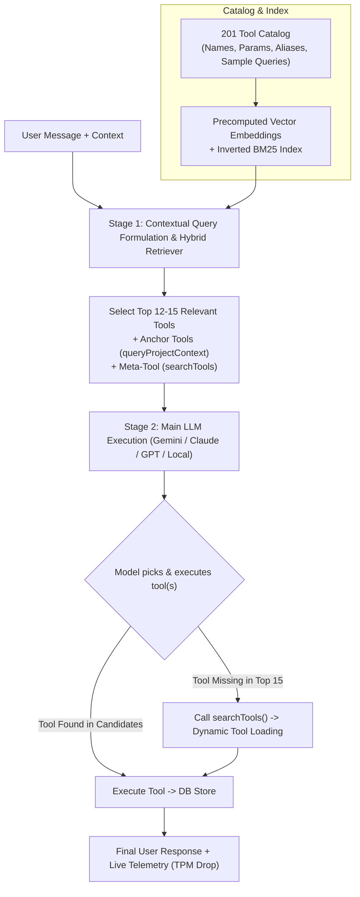

# Hierarchical Multi-Agent Architecture: Retrieval-Based Tool Selection (RAG over Tools)

Move FlowPilot from a flat monolithic tool injection model (passing all 201+ tool schemas on every turn) to a **Two-Stage Hierarchical Retrieval Architecture** (RAG over tools).

This drastically reduces **Tokens Per Minute (TPM)** by over **90%** (from ~48,000+ prompt tokens per call down to ~3,500–4,500 tokens), speeds up model inference and time-to-first-token, prevents context pollution, and maintains 100% reasoning intelligence through multi-guardrail tool retrieval and dynamic tool search.

---

## Architecture Design: Two-Stage Execution

### Stage 1: Cheap / Instant Retrieval
- **Tool Catalog Index**: Index all 201 tools with rich metadata: canonical name, function description, parameters, domain aliases (e.g. "RAID", "SIT", "UAT", "PMO", "burndown"), and sample user intents.
- **Precomputed Embeddings & Inverted Index**: Tool embeddings are precomputed and cached in-memory/JSON (static 201 items). Zero repeated embedding calls for tool definitions.
- **Contextual Query Formulation**: The search query combines the user's latest message with recent turn context and active project state to resolve pronouns and co-references (e.g. "Move the first one to Done" resolves to work item / defect status).
- **Hybrid Retrieval (Dense Cosine Similarity + BM25 Keyword Scoring)**:
  - Supports Google AI `text-embedding-004`, OpenAI `text-embedding-3-small`, or local BM25/Cosine fallback (ensuring offline and LM Studio/Ollama setups work seamlessly without external DB dependencies).
  - Retrieves the top 12–15 candidate tools.
  - Execution time: **< 50ms** (single query embedding + microsecond vector dot-product in Node.js).

### Stage 2: Main Model Decision & Execution
- Main LLM receives:
  - System prompt (with general domain role, freed from 200 hardcoded tool names).
  - Conversation messages.
  - **Only the top 12–15 candidate tool schemas** + **Anchor Tool** (`queryProjectContext`) + **Dynamic Search Meta-Tool** (`searchTools`).
- The model picks and calls the right tool(s) with full reasoning fidelity.

---

## Ensuring Intelligence Is NOT Affected (5 Critical Guardrails)

| Guardrail | Potential Failure Mode | Solution in this Architecture |
|---|---|---|
| **1. Domain Acronym & Jargon Gaps** | Pure vector embeddings might miss acronyms like "RAID", "SIT", "UAT", "PMO", "BCP", "burndown", or "TC-1". | **Hybrid Retrieval**: Combine dense semantic embeddings with BM25 token matching and rich synonym dictionaries for every tool. |
| **2. Multi-Turn Co-reference & Pronouns** | User says "Mark the second one as closed" after viewing defects; query lacks the word "defect". | **Contextual Query Expansion**: Merge recent conversation history (last assistant message / executed actions) into the search query for Stage 1. |
| **3. Multi-Intent / Compound Queries** | "Create a sprint named Sprint 2 and assign story ST-1 to it" requires both `createSprint` and `assignStoryToSprint`. | **Top-15 Candidate Window + Multi-Category Scoring**: Ensures high diversity across relevant functional clusters (Sprint + Story). |
| **4. Essential Baseline Grounding** | User asks general questions or asks what project state looks like. | **Guaranteed Anchor Tools**: `queryProjectContext` is always included in the active toolset. |
| **5. Anthropic-Style Deferred Tool Search** | Obscure tool is ranked #18 and falls just outside top-15. | **Dynamic Meta-Tool (`searchTools`)**: The model can call `searchTools({ query: "..." })` at runtime to retrieve and load any tool from the 201 catalog dynamically. |

---

## Token (TPM) & Performance Impact

- **Before**:
  - 201 tool schemas in context = **~48,000 prompt tokens per turn**.
  - 5-turn conversation = **~240,000+ tokens**.
  - Exceeds TPM rate limits on free/standard tiers quickly; causes slow response generation.
- **After**:
  - 12–15 candidate tool schemas in context = **~3,500 – 4,500 prompt tokens per turn**.
  - Query embedding = **~15 tokens** (uses separate embedding quota, 1500–3000 RPM on Google AI, or 0 tokens if local).
  - **TPM Reduction: ~90% to 92% per request.**
  - **RPM Impact**: Main LLM RPM is unchanged (1 request per user turn). Total token consumption within each minute is cut by ~10x.

---

## User Review Required

> [!NOTE]
> The catalog of 201 tools in ProjectFlow is static code in `flowpilot-tools.ts`. Precomputing and caching their embeddings in a local file (`src/ai/tools-cache.json`) means server restarts take < 5ms and require zero startup API calls.
> If you add or edit tools in the future, a build-time or lazy indexing step automatically refreshes the cache.

> [!TIP]
> The hybrid retriever is designed with a fallback: if `GEMINI_API_KEY` is present, it uses Gemini `text-embedding-004` (super fast and accurate). If running locally with LM Studio or Ollama without Google keys, it automatically falls back to an in-memory BM25 + TF-IDF tokenizer, so it works completely offline with zero extra configuration.

---

## Proposed Changes

### AI Architecture & Tool Retrieval

#### [NEW] [tool-catalog.ts](file:///c:/Users/Raman/Documents/Antigravity/ProjectFlow/src/ai/tools/tool-catalog.ts)
- Comprehensive metadata registry for all 201 FlowPilot tools.
- Maps tool names to categories, detailed descriptions, parameter shapes, domain aliases, synonyms, and trigger phrases.

#### [NEW] [tool-retriever.ts](file:///c:/Users/Raman/Documents/Antigravity/ProjectFlow/src/ai/tools/tool-retriever.ts)
- In-memory hybrid vector & keyword retriever.
- Manages embedding cache (`tools-cache.json`), computes query vector similarity (dot product/cosine), computes BM25 scores, ranks tools, and returns top $K$ candidate tool instances.
- Handles contextual query formulation from multi-turn chat history.

#### [NEW] [tool-search.ts](file:///c:/Users/Raman/Documents/Antigravity/ProjectFlow/src/ai/tools/tool-search.ts)
- Implements the `searchTools` meta-tool (Anthropic-style deferred tool loading).
- Allows the main model to dynamically query the full 201-tool catalog if it detects a needed capability is absent from its 15 candidates.

#### [MODIFY] [flowpilot-tools.ts](file:///c:/Users/Raman/Documents/Antigravity/ProjectFlow/src/ai/flows/flowpilot-tools.ts)
- Export a fast lookup `Map<string, any>` (`flowpilotToolMap`) indexed by tool name.
- Export anchor tools (`queryProjectContextTool`) and the new `searchToolsTool`.

#### [MODIFY] [flowpilot-agent.ts](file:///c:/Users/Raman/Documents/Antigravity/ProjectFlow/src/ai/flows/flowpilot-agent.ts)
- Replace static `tools: allFlowPilotTools` (201 tools) with Stage 1 dynamic tool retrieval:
  - Formulate retrieval query from `lastUserMessage` + recent context.
  - Call `retrieveCandidateTools(query, { maxResults: 14 })`.
  - Pass the retrieved candidates + anchor tools + `searchToolsTool` to `ai.generate`.
- Streamline system prompt by removing the ~2,000-token hardcoded list of 200 tool names (since the candidate tools provide their own exact schemas).
- Expose `retrievedTools` in `TokenUsage` and `RateUtilization` telemetry so the UI and developer can inspect which tools were selected.

---

## Verification Plan

### Automated Tests & Benchmarks
1. **Tool Retrieval Accuracy Benchmark**:
   - Run a standalone validation script `scratch/test-tool-rag.ts` testing 10 diverse representative prompts:
     - QA: "Generate 5 test cases for user authentication" -> Must retrieve `bulkCreateTestCasesTool`, `createTestCaseTool`.
     - RAID: "Log a critical dependency on the backend auth team" -> Must retrieve `createRaidItemTool`, `queryProjectDependenciesTool`.
     - Agile: "Create sprint Sprint 3 and assign ST-2 to it" -> Must retrieve `createSprintTool`, `assignStoryToSprintTool`.
     - Financials: "What is the fixed billing contract value and log an invoice" -> Must retrieve `queryFbBillingSummaryTool`, `logFbInvoiceTool`.
     - Multi-turn pronoun: Follow-up "Move it to Done" -> Must retrieve `updateWorkItemTool`.
2. **Token (TPM) Measurement**:
   - Compare prompt tokens for the same request before vs. after:
     - Before: ~48,000 tokens.
     - After: Target < 4,500 tokens (>90% reduction).
3. **End-to-End Execution**:
   - Run sample chat turn through `/api/flowpilot/chat` and verify:
     - Tool executes correctly.
     - Action is recorded in `executedActions`.
     - UI headers (`x-rate-tpm`, `x-rate-last-prompt-tokens`) show the reduced token metrics.
4. **Type Check**:
   - Run `npx tsc --noEmit` to verify type cleanliness across all modified and new files.
